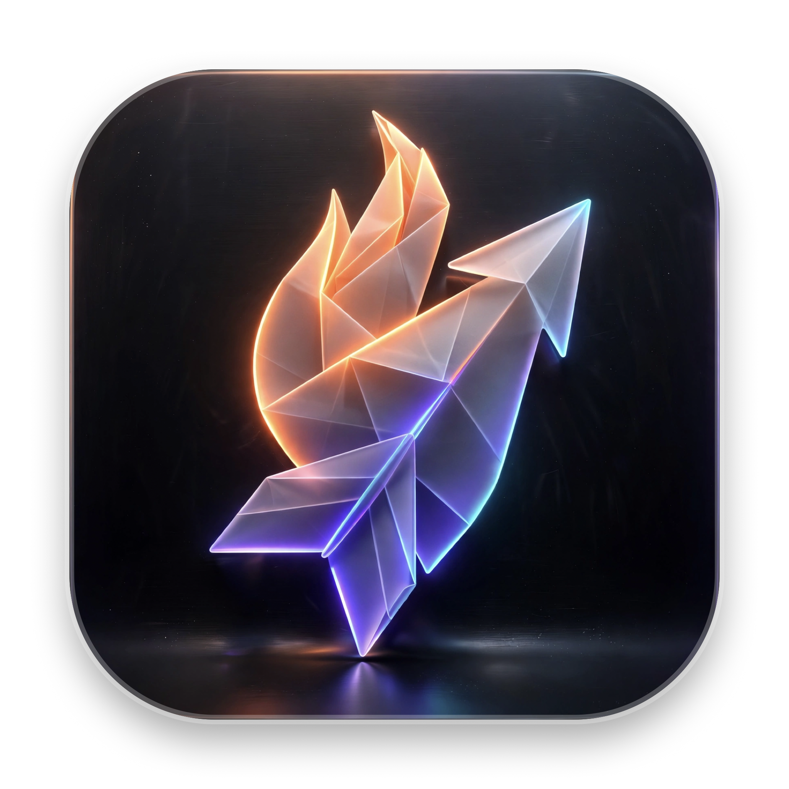

<div align="center">
  
  <h1>SwiftShot</h1>
  <p><strong>A lightning-fast, ultra-lightweight, 100% native macOS screenshot & annotation tool inspired by Flameshot.</strong></p>
  
  <p>
    <a href="https://github.com/luongndcoder/SwiftShot/releases"></a>
    <a href="https://developer.apple.com/macos/"></a>
    <a href="https://swift.org"></a>
    <a href="#ram-comparison"></a>
    <a href="LICENSE"></a>
  </p>
</div>

---

> 🌐 **Language / Ngôn ngữ:** [English](#english) | [Tiếng Việt](#tiếng-việt)

---

<a name="english"></a>
## 🇬🇧 English

### 💡 Why SwiftShot?

[Flameshot](https://github.com/flameshot-org/flameshot) is hands down one of the best screenshot tools ever built. However, running Flameshot on macOS often consumes **over 1.3 GB of RAM** due to its cross-platform Qt6 runtime and background processes, causing sluggishness and frequent security permission popups on modern macOS.

**SwiftShot** is a ground-up, 100% native rewrite for macOS using **Swift**, **ScreenCaptureKit**, **AppKit**, and **CoreGraphics**. It delivers the exact same beloved Flameshot in-place annotation workflow, while dropping memory consumption from **1.3 GB down to ~70 MB** (a 17x reduction!).

### ✨ Key Features

- **🚀 Ultra-Low RAM Footprint**: Idles at ~**70 MB** RSS compared to Flameshot's 1.3 GB.
- **🎯 In-Place HUD Workflow**: No separate preview or pop-up editor window. Annotation tools float dynamically right alongside your selection rectangle.
- **📐 8 Dynamic Resize Handles**: Adjust borders, fine-tune selections, or drag-move the box anywhere on screen.
- **📌 Pin to Desktop (`⌘P`)**: Pin any screenshot region into an always-on-top, draggable, zoomable floating sticker (scroll wheel to zoom in/out, double-click or Esc to close).
- **🔢 Step Counter Badge (`N`)**: Click anywhere to drop auto-incrementing numbered badges (`① ② ③...`) — essential for writing tutorials and documentation.
- **🎨 Complete Annotation Suite**:
  - ↗️ **Arrow** (`A`)
  - 📏 **Line** (`D`)
  - 🔲 **Rectangle** (`R`) & ⬛ **Filled Rectangle**
  - ⭕ **Circle / Ellipse** (`C`)
  - ✏️ **Pencil / Freehand** (`P`)
  - 🖍️ **Marker / Highlighter** (`M`) with semi-transparent multiply blending
  - 💬 **Text** (`T`) with direct typing
  - 💧 **Gaussian Blur** (`B`)
  - 🏁 **Pixelate / Redact**
  - 🎨 **8-Color Quick Palette** & Right-click color picker menu
- **⚡ Pixel-Perfect Retina Capture**: Powered by macOS 14+ `ScreenCaptureKit` with native backing scale resolution.
- **⌨️ Muscle-Memory Shortcuts**:
  - `Command + Shift + 4` (`⇧⌘4`): Activate capture
  - `Command + C` / `Enter`: Copy screenshot directly to Clipboard
  - `Command + S`: Save PNG to `~/Pictures/SwiftShot/`
  - `Command + Z` / `Shift + Command + Z`: Undo / Redo
  - `Esc`: Cancel capture
  - `Arrow Keys`: Nudge selection by 1px (`Shift + Arrows` to resize by 1px)
  - `Mouse Wheel`: Scroll to instantly increase/decrease tool stroke thickness
- **🔒 Stable TCC Permissions**: Signs with a persistent developer signature so macOS Screen Recording permission is granted **only once** and never lost on rebuilds.

### 📊 RAM Comparison

| Screenshot App | Technology Stack | Idle RAM | Active Capture RAM |
| :--- | :--- | :---: | :---: |
| **Flameshot** | C++ / Qt6 Runtime | **~1,300 MB** | ~1,450 MB |
| **SwiftShot** | **100% Native Swift / AppKit** | **~70 MB** | **~85 MB** |

---

### 📦 Installation

#### Option 1: One-Click Build & Install from Source (Recommended)

Requires macOS 14.0+ and Xcode command line tools:

```bash
git clone https://github.com/luongndcoder/SwiftShot.git
cd SwiftShot
./install.sh
```

The script builds the Release binary, codesigns it with your local Apple Development certificate, installs it to `/Applications/SwiftShot.app`, and launches it automatically.

#### Option 2: Build via Xcode

```bash
brew install xcodegen   # One-time tool to generate .xcodeproj
./generate.sh
open SwiftShot.xcodeproj
```

Press **⌘R** to run.

---

### ⚙️ First-Time Setup (Important)

1. **Grant Screen Recording Permission**:
   - Go to **System Settings** → **Privacy & Security** → **Screen Recording**.
   - Toggle **SwiftShot** to **ON**. (You only need to do this once).
2. **Override default macOS `⇧⌘4` shortcut**:
   - Go to **System Settings** → **Keyboard** → **Keyboard Shortcuts...** → **Screenshots**.
   - **Uncheck** *Save picture of selected area as a file* (`⇧⌘4`).
   - Now pressing **`Command + Shift + 4`** will instantly trigger SwiftShot!

---

<a name="tiếng-việt"></a>
## 🇻🇳 Tiếng Việt

### 💡 Tại sao lại có SwiftShot?

[Flameshot](https://github.com/flameshot-org/flameshot) là một công cụ chụp ảnh màn hình tuyệt vời. Tuy nhiên trên macOS, Flameshot thường ngốn tới **hơn 1.3 GB RAM** do chạy trên runtime Qt6 cồng kềnh, gây lag máy và thường xuyên bị mất quyền quay màn hình sau mỗi lần khởi động.

**SwiftShot** là ứng dụng viết lại hoàn toàn native 100% cho macOS bằng **Swift**, **ScreenCaptureKit** và **AppKit**. Giữ nguyên vẹn trải nghiệm vẽ chú thích in-place cực tiện của Flameshot nhưng cắt giảm RAM từ **1.3 GB xuống chỉ còn ~70 MB** (nhẹ hơn 17 lần!).

### ✨ Tính năng nổi bật

- **🚀 Siêu nhẹ & Native 100%**: Chỉ chiếm ~**70 MB RAM**, không phụ thuộc Electron, không dùng Qt runtime.
- **🎯 Giao diện HUD In-Place**: Không mở cửa sổ preview riêng biệt. Toàn bộ thanh công cụ nổi ngay sát khung chọn của bạn.
- **📐 8 Điểm điều khiển (Handles)**: Tự do co giãn 4 góc, 4 cạnh và kéo di chuyển khung chọn khắp màn hình.
- **📌 Ghim ảnh lên màn hình (`⌘P`)**: Ghim vùng vừa chụp thành sticker nổi `always-on-top` (cuộn chuột phóng to/thu nhỏ, nhấp đúp hoặc Esc để đóng).
- **🔢 Đánh số bước tự động (`N`)**: Click tới đâu đánh số thứ tự `① ② ③...` tới đó — tính năng đắc lực cho viết tài liệu kỹ thuật và hướng dẫn.
- **🎨 Full bộ công cụ chú thích**: Mũi tên (`A`), Đường thẳng (`D`), Chữ nhật (`R`), Hình tròn (`C`), Bút chì (`P`), Bút dạ quang (`M`), Gõ chữ (`T`), Làm mờ (`B`), Che điểm ảnh (Pixelate).
- **⚡ Độ sắc nét Retina**: Tận dụng `ScreenCaptureKit` trên macOS 14+ chụp chuẩn từng pixel 1:1.
- **⌨️ Hệ thống phím tắt chuẩn Flameshot**:
  - `Command + Shift + 4` (`⇧⌘4`): Kích hoạt chụp
  - `Command + C` / `Enter`: Copy ảnh vào bộ nhớ tạm
  - `Command + S`: Lưu file PNG vào `~/Pictures/SwiftShot/`
  - `Command + P`: Ghim ảnh lên màn hình
  - `Command + Z` / `⇧⌘Z`: Undo / Redo
  - `Esc`: Thoát chế độ chụp
  - `Lăn chuột`: Tăng / giảm độ dày nét vẽ tức thì
- **🔒 Cấp quyền 1 lần duy nhất**: Ký bằng chứng chỉ Apple Developer chuẩn giúp quyền Screen Recording tồn tại vĩnh viễn, không bị hỏi lại khi cập nhật code.

---

### 🛠️ Cài đặt & Sử dụng

```bash
git clone https://github.com/luongndcoder/SwiftShot.git
cd SwiftShot
./install.sh
```

Sau khi chạy xong, app sẽ nằm trong `/Applications/SwiftShot.app` và icon kính ngắm xuất hiện trên thanh Menu Bar.

---

### 📄 License

Distributed under the **MIT License**. See `LICENSE` for more information.

### 💖 Acknowledgements

- Inspired by the incredible work of the [Flameshot](https://github.com/flameshot-org/flameshot) team.
- App icon artwork crafted with modern Apple Human Interface Guidelines aesthetic.
