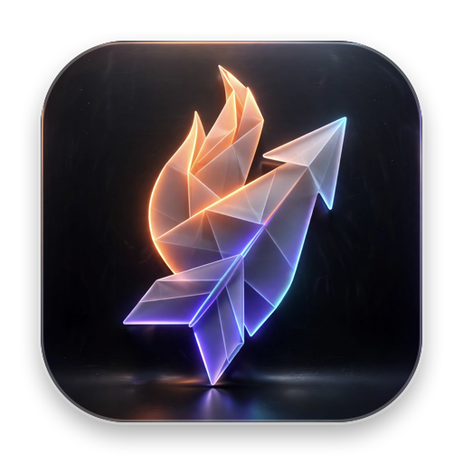

<div align="center">
  
  <h1>SwiftShot</h1>
  <p><strong>A lightning-fast, ultra-lightweight, 100% native macOS screenshot, screen recording & annotation suite — featuring Cursorful-style auto-zoom and an MCP server for AI coding agents.</strong></p>

  <p>
    <a href="https://github.com/luongndcoder/SwiftShot/releases"></a>
    <a href="https://developer.apple.com/macos/"></a>
    <a href="https://swift.org"></a>
    <a href="#-ram-comparison"></a>
    <a href="LICENSE"></a>
  </p>
</div>

---

> 🌐 **Language / Ngôn ngữ:** [English](#english) | [Tiếng Việt](#tiếng-việt)

---

<a name="english"></a>
## 🇬🇧 English

### 💡 Why SwiftShot?

[Flameshot](https://github.com/flameshot-org/flameshot) has long been considered one of the best screenshot tools available. However, on macOS, Flameshot often consumes **over 1.3 GB of RAM** due to its cross-platform Qt6 runtime, leading to micro-stutters and frequent TCC permissions resets across system reboots.

**SwiftShot** is a ground-up, 100% native macOS application engineered with **Swift**, **ScreenCaptureKit**, **AppKit**, and **CoreGraphics**. It retains the beloved in-place annotation workflow while expanding into **Screen Recording**, **Cursorful-style Auto-Zoom**, and a built-in **MCP server** for AI coding assistants — all while slashing RAM usage from **1,300 MB down to ~70 MB** (a ~18x reduction!).

---

### ✨ Key Features

#### 📸 Capture & In-Place Annotation
- **Glass Pro HUD**: A modern, liquid frosted glass toolbar that floats directly alongside your selection — no intrusive pop-up windows or modal editors.
- **Retina Pixel-Perfect Quality**: Powered natively by macOS 14+ `ScreenCaptureKit` at full display backing scale.
- **8 Dynamic Control Handles**: Directional resize cursors (`↔`, `↕`, `⇱`, `⇲`), drag-move hand cursor (`🖐` → `✊`), aspect-locked resize (`Ctrl`), and symmetric resize (`Shift`).
- **Precision Magnifier & Eyedropper (`G`)**: Live loupe with real-time RGB/HEX color readout and pixel grid alignment.
- **Full Annotation Arsenal**:
  - ↗️ Arrow (`A`) · 📏 Line (`D`) · 🔲 Rectangle (`R`) · ⬛ Filled Rectangle · ⭕ Ellipse (`C`)
  - ✏️ Freehand Pencil (`P`) · 🖍️ Highlighter Marker (`M`) · 💬 Inline Text (`T`)
  - 🔢 Auto-Increment Step Badges (`N`): Click anywhere to drop numbered counters (① ② ③...).
  - 💧 Blur (`B`) & Pixelate: Obscure sensitive tokens, passwords, or personal details cleanly.
  - 🔄 Color Invert (`I`): Emphasize specific UI elements with inverted luminescence.
  - 🎨 8-color quick palette, macOS Native Color Picker, and custom user color presets.
- **📌 Pin to Desktop (`⌘P`)**: Turn any capture into an always-on-top, draggable, zoomable floating sticker.

#### 🌐 OCR, Smart Text Copy & In-Place Translation (New in v1.2.0)
- **On-Device Apple Vision OCR**: Extracts text from any screenshot instantly with 100% privacy, high accuracy, and spatial bounding boxes.
- **Smart Text Extraction & Copy (`text.viewfinder`)**: Copy all recognized text at once, or interactively select specific lines/blocks with visual boundary highlights on the canvas.
- **Google Translate (Free Default)**: Built-in translation using Google's public endpoint — works out of the box with zero API keys or configuration needed.
- **OpenAI API Compatible**: Connect your OpenAI key or any compatible endpoint (OpenRouter, DeepSeek, LocalAI, Ollama) for context-aware AI translation (`gpt-4o-mini`, `gpt-4o`).
- **In-Place Image Text Overlay**: Directly renders translated text blocks with rounded dark backdrops over the original text on the canvas — allowing you to copy (`⌘C`) or save (`⌘S`) the translated image directly!
- **Interactive Floating Translation Panel**: Switch target languages on the fly, view side-by-side original & translated text, copy translated text, or toggle the image overlay.
- **Live In-Place Progress Indicator**: Frosted glass spinning indicator and HUD status update immediately when OCR or translation begins.

#### 🎥 Screen Recording (New in v1.2.0)
- **Display & Region Recording**: Record your entire screen or a cropped area with low CPU overhead.
- **System Audio Capture**: Directly captures clean system audio output via ScreenCaptureKit streams.
- **Countdown Timer**: 3-second visual countdown to prepare your workspace before capture starts.
- **Status Bar Live Indicator**: Real-time elapsed duration indicator with quick one-click stop.

#### 🔍 Cursorful-Style Auto-Zoom (New in v1.2.0)
- **Cursor Path Tracking**: Records smooth cursor trajectories, velocities, and click events during screen recording.
- **Smart Dynamic Pan & Zoom**: Post-processes recorded video with buttery-smooth cinematic zooms into the cursor's focus area (inspired by tools like Cursorful and Screen Studio).
- **Pro Demo Export**: Produces high-resolution, presentation-grade videos ready for product demos, bug reports, and tutorials.

#### 🤖 Built-in MCP Server (Model Context Protocol)
SwiftShot is the first macOS screenshot tool designed for AI coding agents (Claude Code, Cursor, Windsurf, Continue, Zed, etc.).
- Agents query screen state and receive pixel data directly over stdio/JSON-RPC.
- **Zero Permission Popups**: The MCP daemon bridges to the running SwiftShot app over a Unix domain socket, reusing SwiftShot's already-granted Screen Recording permissions.

#### 🔄 Auto-Update & Preferences
- **Integrated Update Checker**: Silent background checks or manual updates directly from GitHub Releases.
- **Ad-Hoc Safe**: Safely updates application binaries without losing system TCC Screen Recording grants or stored `UserDefaults`.
- **Comprehensive Settings**: Customize global keyboard shortcuts, default save locations (`~/Pictures/SwiftShot`), auto-copy toggles, file format (PNG / JPEG with quality control), and UI opacity.

---

### 📊 RAM Comparison

| Screenshot App | Technology Stack | Idle RAM | Active Capture RAM |
| :--- | :--- | ---: | ---: |
| **Flameshot** | C++ / Qt6 Runtime | **~1,300 MB** | ~1,450 MB |
| **CleanShot X** | Swift / Commercial | ~110 MB | ~140 MB |
| **SwiftShot** | **100% Native Swift / AppKit / ScreenCaptureKit** | **~70 MB** | **~85 MB** |

---

### 🤖 MCP Server — Give Your AI Eyes

```
┌─────────────────┐       stdio / JSON-RPC       ┌────────────────────┐
│ AI Coding Agent │ ───────────────────────────> │   swiftshot-mcp    │
│  (Claude Code)  │ <─────────────────────────── │ (daemon in bin/)   │
└─────────────────┘                              └─────────┬──────────┘
                                                           │ Unix Socket
                                                           ▼
                                                 ┌────────────────────┐
                                                 │   SwiftShot.app    │
                                                 │ (Holds TCC Grant)  │
                                                 └────────────────────┘
```

#### Available MCP Tools

| Tool | Parameters | Description |
| :--- | :--- | :--- |
| `swiftshot_capture` | `region` (optional), `format` (`png`/`jpeg`) | Takes a screenshot of full screen or specified region and returns base64 image data. |
| `swiftshot_displays` | None | Returns active display IDs, names, frame boundaries, and retina scale factors. |
| `swiftshot_status` | None | Checks app version, process status, and TCC Screen Recording authorization. |
| `swiftshot_settings` | `settings` (optional dict) | Reads or modifies user configuration keys. |
| `swiftshot_open_settings` | None | Opens SwiftShot's preferences window. |

#### Setup with Claude Code or Cursor

1. Install app and MCP binary:
```bash
./install.sh
./install-mcp.sh
```

2. Register with Claude Code:
```bash
claude mcp add swiftshot -- ~/.local/bin/swiftshot-mcp
```

Or add to your client config (`~/.cursor/mcp.json` / `claude_desktop_config.json`):
```json
{
  "mcpServers": {
    "swiftshot": {
      "command": "/Users/<your-username>/.local/bin/swiftshot-mcp"
    }
  }
}
```

3. Ensure SwiftShot is running in the menu bar:
```bash
open -a SwiftShot
```

---

### ⌨️ Keyboard Shortcuts & Modifiers

| Shortcut | Action |
| :--- | :--- |
| `⌘⇧4` | Trigger region capture overlay |
| `⌘C` / `Enter` | Copy current selection / composite to clipboard |
| `⌘S` | Quick save to configured pictures directory |
| `⇧⌘S` | Save As… with interactive file dialog |
| `⌘P` | Pin current selection as desktop floating sticker |
| `⌘Z` / `⇧⌘Z` | Undo / Redo annotation actions |
| `Esc` | Dismiss capture or recording session |
| `Delete` / `Backspace` | Delete currently selected annotation |
| `A` `D` `R` `C` | Arrow, Line, Rectangle, Ellipse |
| `P` `M` `T` `N` | Pencil, Highlighter, Inline Text, Step Counter |
| `B` `I` `G` | Blur/Mosaic, Color Invert, Eyedropper Loupe |
| `Ctrl` + drag | Snap angles to 45°/90° or maintain 1:1 aspect ratio |
| `Shift` + resize | Symmetrically resize around center |
| `← ↑ → ↓` | Nudge selection by 1 point (`Shift` by 10 points) |

---

### 📦 Installation

#### Option 1: Direct Download (Prebuilt)
Download the latest `SwiftShot-v1.3.0-macOS.zip` from [GitHub Releases](https://github.com/luongndcoder/SwiftShot/releases), unzip, and drag `SwiftShot.app` into `/Applications`.

#### Option 2: Build & Install from Source
```bash
git clone https://github.com/luongndcoder/SwiftShot.git
cd SwiftShot
./install.sh
```

#### Option 3: Xcode Project Generation
```bash
brew install xcodegen
./generate.sh
open SwiftShot.xcodeproj
```

---

<a name="tiếng-việt"></a>
## 🇻🇳 Tiếng Việt

### 💡 Giới thiệu về SwiftShot

[Flameshot](https://github.com/flameshot-org/flameshot) là một công cụ chụp ảnh màn hình rất được yêu thích. Tuy nhiên trên macOS, việc Flameshot chạy qua runtime Qt6 khiến ứng dụng thường xuyên ngốn **hơn 1.3 GB RAM**, gây giật nhẹ khi gọi công cụ và dễ bị macOS thu hồi quyền ghi hình màn hình (Screen Recording) sau mỗi lần cập nhật hoặc khởi động lại.

**SwiftShot** được viết lại hoàn toàn native 100% cho macOS bằng **Swift**, **ScreenCaptureKit**, **AppKit** và **CoreGraphics**. Ứng dụng mang đến trải nghiệm chỉnh sửa in-place mượt mà, bổ sung thêm tính năng **Quay màn hình**, **Auto-Zoom phong cách Cursorful/Screen Studio**, và tích hợp **MCP server** cho các AI coding agent — trong khi mức tiêu thụ RAM giảm từ **1,300 MB xuống chỉ còn ~70 MB** (nhẹ hơn ~18 lần!).

---

### ✨ Tính năng nổi bật

#### 📸 Chụp màn hình & Chú thích In-Place
- **Giao diện Glass Pro HUD**: Thanh công cụ kính mờ liquid frosted glass chuẩn macOS, bám sát vùng chọn mà không bật cửa sổ popup gây phân tâm.
- **Chất lượng Retina Native**: Chụp ảnh sắc nét với độ phân giải thực thông qua Apple `ScreenCaptureKit`.
- **8 Điểm điều khiển linh hoạt**: Tự động đổi con trỏ chuột theo hướng kéo (`↔`, `↕`, `⇱`, `⇲`), bàn tay di chuyển vùng chọn (`🖐` → `✊`), giữ tỉ lệ (`Ctrl`) và co giãn đối xứng (`Shift`).
- **Kính lúp phóng to & Soi màu (`G`)**: Hiển thị giá trị màu RGB / HEX theo thời gian thực tại vị trí pixel con trỏ chuột.
- **Bộ công cụ vẽ chú thích hoàn chỉnh**:
  - ↗️ Mũi tên (`A`) · 📏 Đường thẳng (`D`) · 🔲 Hình chữ nhật (`R`) · ⬛ Hình chữ nhật đặc · ⭕ Hình elip (`C`)
  - ✏️ Bút vẽ tự do (`P`) · 🖍️ Bút dạ quang Highlighter (`M`) · 💬 Nhập chữ trực tiếp (`T`)
  - 🔢 Đánh số thứ tự tự động (`N`): Click tới đâu tự tăng số thứ tự ① ② ③...
  - 💧 Làm mờ (Blur) (`B`) & Pixelate: Che nhanh token, mật khẩu hoặc thông tin nhạy cảm.
  - 🔄 Đảo màu (Invert) (`I`): Tạo điểm nhấn tương phản cho chi tiết cần lưu ý.
  - 🎨 Bảng 8 màu chuẩn, macOS Color Picker và lưu bảng màu yêu thích (Custom Presets).
- **📌 Ghim lên màn hình (`⌘P`)**: Biến vùng vừa chụp thành sticker nổi luôn ở trên cùng (Always-on-top), hỗ trợ kéo thả và cuộn chuột phóng to/thu nhỏ.

#### 🌐 OCR, Copy văn bản thông minh & Dịch thuật trên ảnh (Mới trong v1.2.0)
- **Nhận diện chữ on-device bằng Apple Vision**: Quét chữ từ ảnh chụp màn hình cực nhanh, hoàn toàn bảo mật và giữ nguyên toạ độ hiển thị của từng dòng chữ.
- **Trích xuất & Copy văn bản thông minh (`text.viewfinder`)**: Cho phép sao chép toàn bộ văn bản hoặc tích chọn copy từng dòng/khối văn bản cụ thể, kèm viền đứt nét highlight trực quan trên ảnh.
- **Google Dịch miễn phí (Mặc định)**: Sử dụng endpoint dịch miễn phí của Google — chạy ngay lập tức không cần đăng ký tài khoản hay API key.
- **Hỗ trợ OpenAI API & các bên tương thích**: Dễ dàng tích hợp OpenAI (`gpt-4o-mini`, `gpt-4o`), OpenRouter, DeepSeek, Ollama với Base URL và API key riêng.
- **Dịch đè trực tiếp lên ảnh (In-Place Overlay)**: Vẽ các khối chữ đã dịch đè chính xác lên vị trí chữ gốc trên ảnh — cho phép bạn sao chép (`⌘C`) hoặc lưu (`⌘S`) ảnh đã dịch một cách tự nhiên!
- **Bảng điều khiển dịch nổi**: Cho phép đổi ngôn ngữ đích linh hoạt, xem song ngữ bản gốc và bản dịch, sao chép nhanh và bật/tắt lớp phủ trên ảnh.
- **Hiển thị Loading rõ ràng**: Huy hiệu kính mờ xoay mượt mà ngay trên vùng chọn và trạng thái rõ ràng trên thanh HUD, phản hồi tức thì khi bấm nút.

#### 🎥 Quay video màn hình (Mới trong v1.2.0)
- **Quay toàn màn hình hoặc theo vùng chọn**: Tối ưu hóa hiệu năng với ScreenCaptureKit, tiêu tốn cực ít tài nguyên CPU.
- **Thu âm thanh hệ thống (System Audio)**: Ghi trực tiếp âm thanh phát ra từ máy Mac với chất lượng trong trẻo.
- **Đếm ngược thông minh**: 3 giây chuẩn bị trước khi bắt đầu ghi hình.
- **Đồng hồ thời gian thực trên Menu Bar**: Theo dõi thời lượng quay và dừng nhanh chỉ với một cú click.

#### 🔍 Auto-Zoom mượt mà chuẩn Cursorful (Mới trong v1.2.0)
- **Tự động bắt chuyển động chuột**: Ghi nhận toàn bộ toạ độ, tốc độ và các lượt click chuột trong lúc quay.
- **Dynamic Pan & Zoom**: Render hậu kỳ thông minh, tự động lia góc quay và phóng to mượt mà vào vùng thao tác chính (tương tự Cursorful, Screen Studio).
- **Xuất video chuẩn demo**: Rất thích hợp làm video hướng dẫn sản phẩm, báo cáo bug hoặc đăng tải mạng xã hội.

#### 🤖 MCP Server cho AI Coding Agent
SwiftShot đi kèm **Model Context Protocol server**, cho phép các trợ lý lập trình AI (như Claude Code, Cursor, Windsurf, Zed...) tự động chụp ảnh màn hình và phân tích pixel trực tiếp:
- **Không lo hỏi quyền TCC**: `swiftshot-mcp` giao tiếp với ứng dụng SwiftShot qua Unix socket, kế thừa quyền Screen Recording đã cấp cho app.
- **Tích hợp nhanh**: Dễ dàng kết nối với Claude Code thông qua lệnh `claude mcp add`.

#### 🔄 Tự động cập nhật & Cài đặt
- **Cập nhật thông minh**: Kiểm tra bản cập nhật mới nhất từ GitHub Releases một cách an toàn mà không làm mất quyền Screen Recording.
- **Tuỳ biến linh hoạt**: Tuỳ chỉnh phím tắt toàn hệ thống, thư mục lưu tự động (`~/Pictures/SwiftShot`), định dạng ảnh (PNG lossless / JPEG tuỳ chỉnh chất lượng).

---

### 📊 So sánh mức sử dụng RAM

| Ứng dụng | Công nghệ | RAM khi chạy ngầm | RAM khi chụp |
| :--- | :--- | ---: | ---: |
| **Flameshot** | C++ / Qt6 Runtime | **~1,300 MB** | ~1,450 MB |
| **CleanShot X** | Swift / Bản thương mại | ~110 MB | ~140 MB |
| **SwiftShot** | **100% Native Swift / AppKit / ScreenCaptureKit** | **~70 MB** | **~85 MB** |

---

### 🤖 Đăng ký MCP Server với Claude Code

```bash
# 1. Cài đặt app và server MCP
./install.sh
./install-mcp.sh

# 2. Thêm vào Claude Code
claude mcp add swiftshot -- ~/.local/bin/swiftshot-mcp

# 3. Mở app SwiftShot
open -a SwiftShot
```

---

### ⌨️ Phím tắt thao tác nhanh

| Phím tắt | Chức năng |
| :--- | :--- |
| `⌘⇧4` | Kích hoạt vùng chọn chụp màn hình |
| `⌘C` / `Enter` | Copy vùng chọn vào Clipboard |
| `⌘S` | Lưu nhanh vào thư mục ảnh mặc định |
| `⇧⌘S` | Mở hộp thoại "Lưu dưới dạng..." |
| `⌘P` | Ghim ảnh nổi lên màn hình |
| `⌘Z` / `⇧⌘Z` | Hoàn tác (Undo) / Làm lại (Redo) |
| `Esc` | Hủy bỏ chụp / quay |
| `Delete` | Xóa chú thích đang chọn |
| `A` `D` `R` `C` | Mũi tên, Đường thẳng, Chữ nhật, Elip |
| `P` `M` `T` `N` | Bút vẽ, Dạ quang, Chữ, Đánh số thứ tự |
| `B` `I` `G` | Làm mờ, Đảo màu, Kính lúp soi màu |
| `Ctrl` + kéo chuột | Khóa góc 45°/90° hoặc giữ tỉ lệ vuông / tròn |
| `Shift` + kéo cạnh | Co giãn đối xứng qua tâm |
| `Phím mũi tên` | Dịch chuyển vùng chọn 1 pixel (`Shift` dịch 10 pixel) |

---

### 📦 Hướng dẫn cài đặt

#### Cách 1: Tải bản đóng gói sẵn (Khuyên dùng)
Tải file `SwiftShot-v1.3.0-macOS.zip` tại [GitHub Releases](https://github.com/luongndcoder/SwiftShot/releases), giải nén và kéo `SwiftShot.app` vào thư mục `/Applications`.

#### Cách 2: Cài đặt từ mã nguồn
```bash
git clone https://github.com/luongndcoder/SwiftShot.git
cd SwiftShot
./install.sh
```

---

### 🛠️ Các lệnh dành cho lập trình viên

```bash
./generate.sh                      # Tạo lại project Xcode từ project.yml (yêu cầu xcodegen)
./install.sh                       # Build, ký ad-hoc và cài đặt vào /Applications
./package.sh 1.3.0                 # Đóng gói bản phát hành signed zip vào dist/
./install-mcp.sh                   # Build và cài đặt MCP server vào ~/.local/bin
python3 Tests/e2e_mcp.py           # Chạy test E2E cho MCP server
cd MCP && swift build -c release   # Build riêng module MCP server
```

---

### 📄 License

Phát hành dưới giấy phép **MIT License**. Chi tiết xem tại [LICENSE](LICENSE).

### 💖 Lời cảm ơn

- Cảm hứng thiết kế từ đội ngũ phát triển [Flameshot](https://github.com/flameshot-org/flameshot).
- Giao diện và biểu tượng ứng dụng tuân thủ triết lý Human Interface Guidelines của Apple.
